# The Moment Design Doc

An online, publicly curated digital museum for contemporary art. Artists post into rotating wings and galleries, visitors upvote what resonates, and everyone nominates what gets shown next.

---

## Concept Design from P1

| | P1 | Final |
| --- | --- | --- |
| Concepts | Posting, Upvoting, Grouping, Cycling | Same four, plus **Nominating**, **Administrating**, **Uploading**, Authenticating, Sessioning |
| Voting | the principle mentions upvotes *and* downvotes | upvote only, with no way to dislike |
| Who decides the galleries | the admin (me) | the public, through weekly nominations that admins turn into galleries |
| Cycling | stores runs and switches items active or inactive | stores only start, period, and number of runs; what's live is calculated |
| Wings vs. galleries | separate ideas | the same Grouping; a wing is just a longer cycle (30 or more days) |
| Navigation | a list of wings and galleries | a museum floor plan you walk through |
| Admin | hardcoded to me | one owner who adds and removes admins |

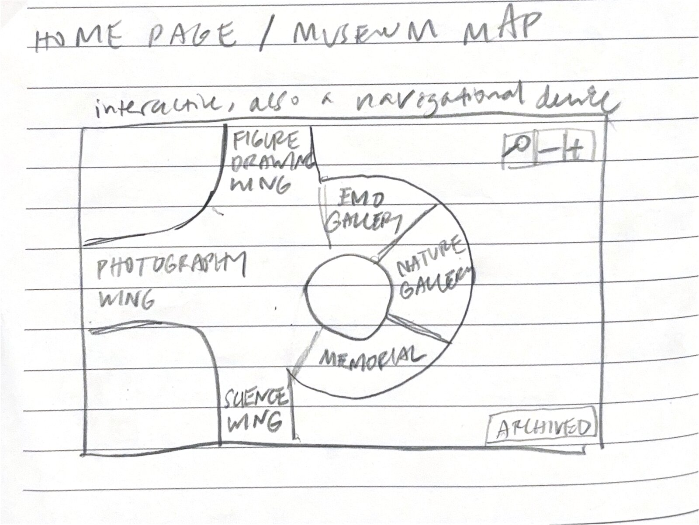 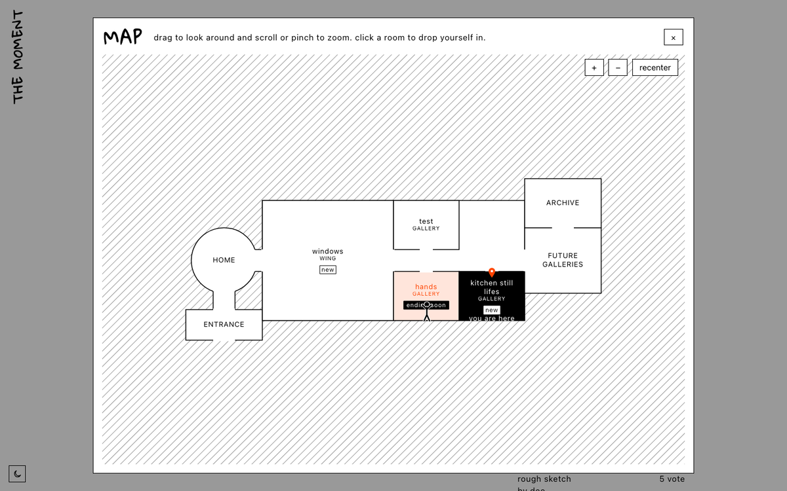

*P1 sketch (left) vs. the final map overlay (right).*

## Visual Design from P3

**Kept**
- Portfolio-style restraint: the art is the only color on the page.
- Handwritten titles (Gloria Hallelujah) over a neutral body font.
- Black and white plus one accent (#ff4400).

**Changed**
- **Accent color marks interaction** Hovers, the upvote wash, POST + and NOMINATE + all use it, instead of it only decorating the brand.
- **Dark mode**, with its own accent (#c4f318), because inverted orange read poorly on black.
- **An entrance** with a doorway and a half-artist, half-visitor figure that lights up the side you're reading.
- **Accessibility pass**: screen reader labels, a skip link, visible focus, and keyboard-operable map and menus.

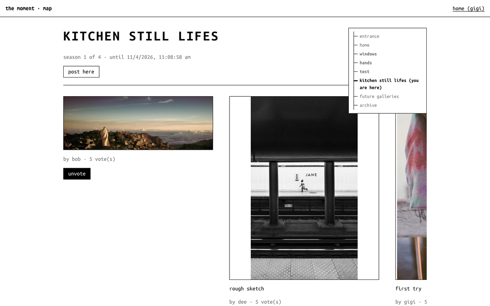 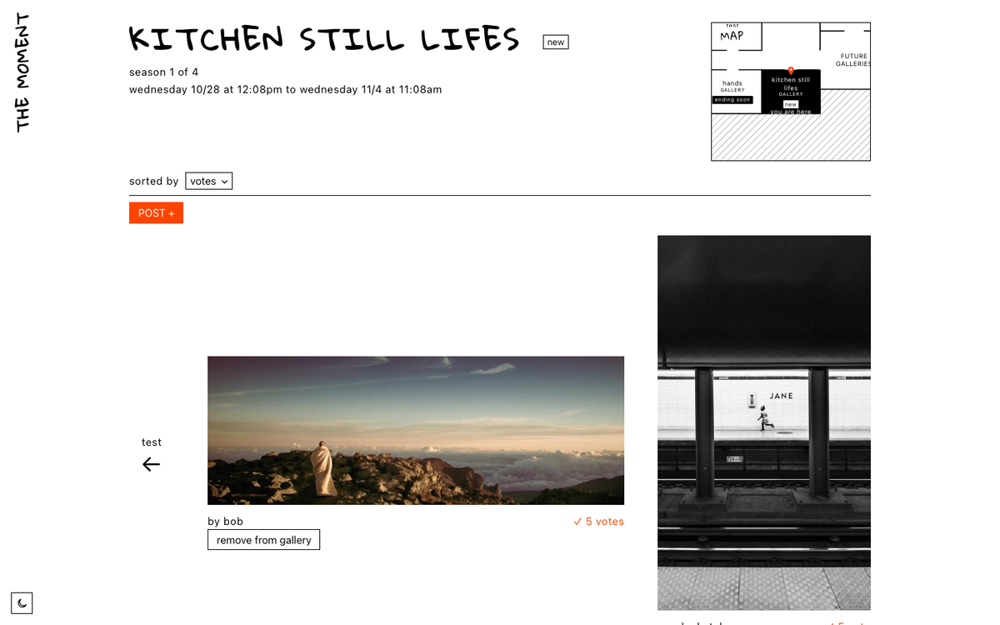

*Gallery wall at the end of P3 (left) vs. final (right).*

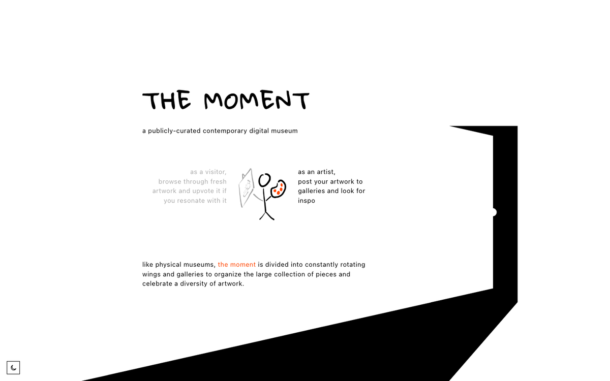 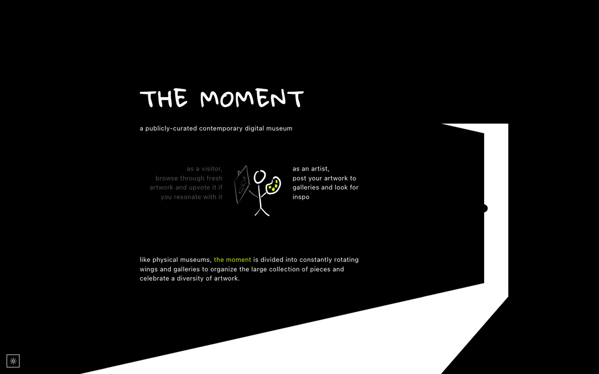

---

## Key decisions

### 1. Collective, not personal
The app curates a public taste, not a personal one, so I was constantly fighting the urge to "personalize" the experience.
- **Cut the profile page.** "My upvotes" was leading toward personal curation and favoriting. Home now just manages your own posts and nominations.
- **No Moderating concept.** Public curation is the filter: what people don't upvote sinks. Admins can remove a post from a gallery (for misfiled or broken posts), but there's no reporting or review queue.

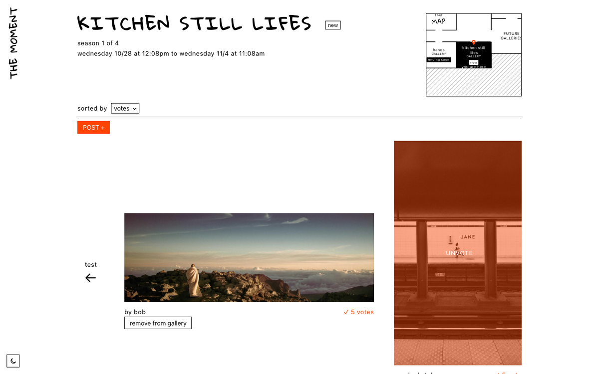 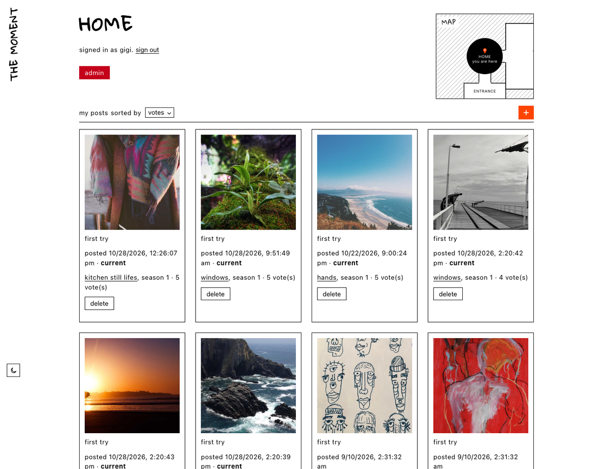

### 2. Why should artists post?
Many friends initially reacted to the app idea by asking what an artist gets by posting if it's not followers or likes. Instead of adding a karma concept, I maintained that the incentive is being part of a lasting collection, like Radiooooo:
- An **Archive** keeps every past season, searchable, with its dates.
- **Nominating** lets anyone shape which galleries open next. 

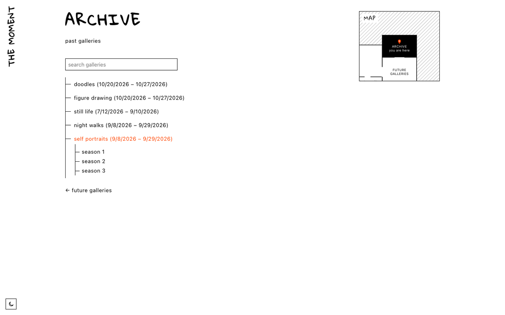 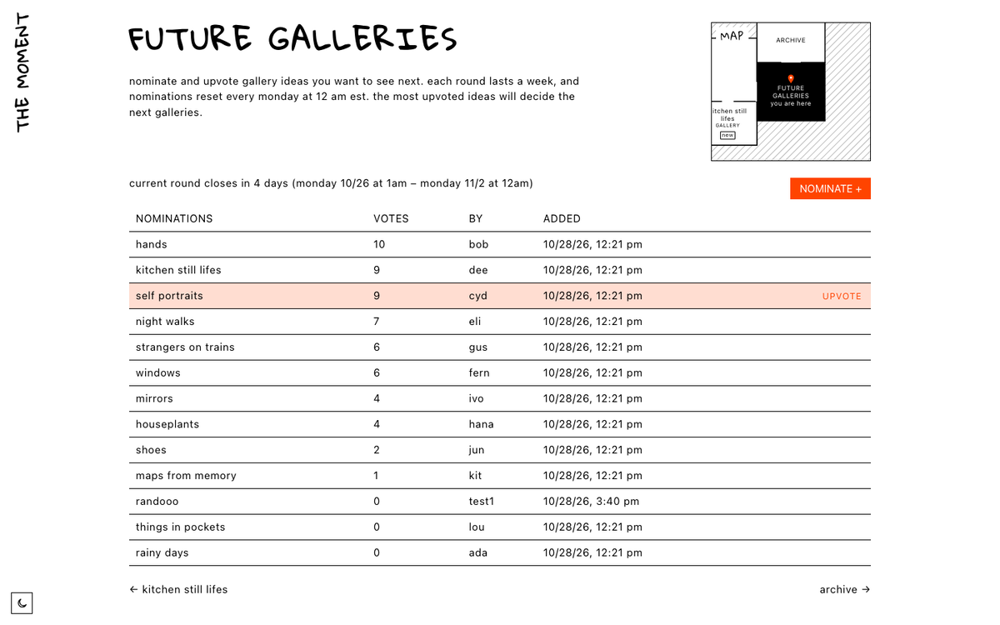

### 3. Simple concepts, simpler interface
- **Generic concepts with specific uses.** Nominating has "categories," but the app only ever needs one ("Future galleries"), so the category is hardcoded and never shown.
- **The admin page used to mirror the backend.** It had five sections (nominations, builder, galleries, cycles, people) that matched my concepts. I cut it down to expose only the necessary choices an admin actually makes: season length, number of seasons, start date, and gallery names, typed in or picked from nominations. 

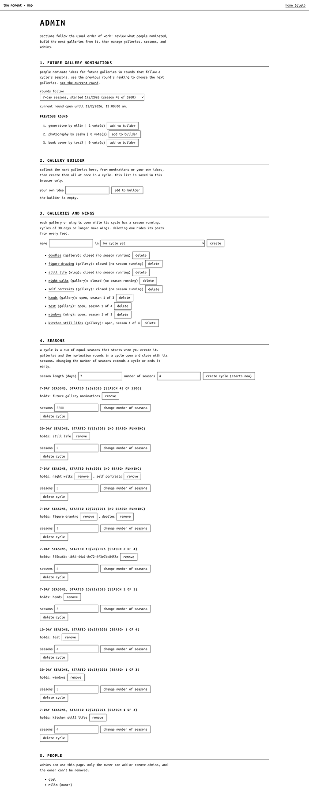 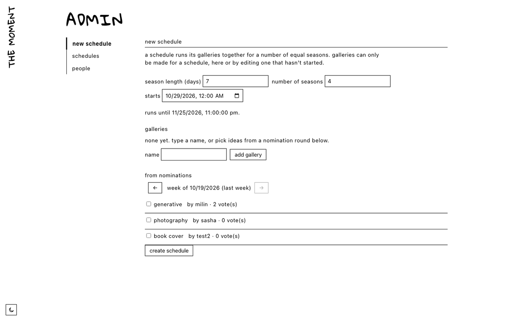

*Admin before: one long page of forms (left). After: one form for a new schedule (right).*

### 4. Designing for scale and time
- **The archive is one room, not one room per past gallery**, so the map never grows forever. A search bar takes over once the list is too long to skim.
- **Season notices** ("new", "ending soon", "current round closes in…") make the time limits visible.
- **Nominations reset every Monday at 12am EST.** The weekly cycle behind that stays hidden; the UI only shows when the current round closes.

